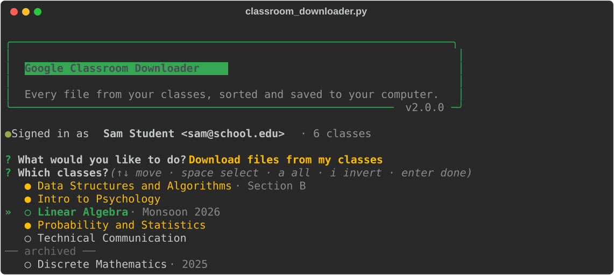
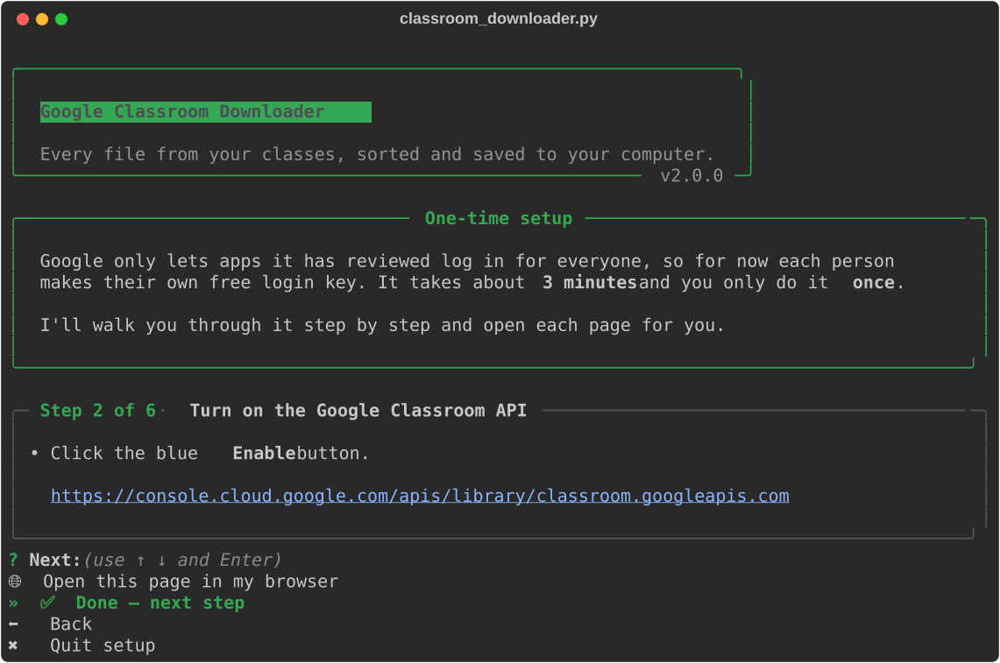
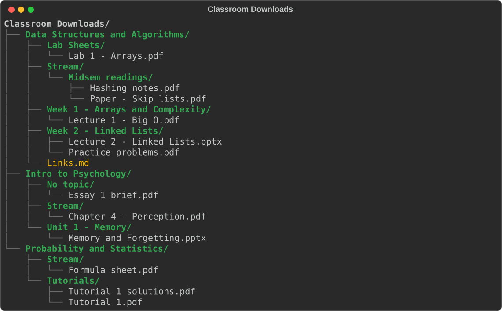

# Google Classroom Downloader

Downloads every file from your Google Classroom classes, sorted into folders by topic.

<p align="center">
  
</p>

- Gets Classwork materials, assignments, and files posted on the Stream
- Sorts files into folders named after your class's topics
- Downloads attached Drive folders
- Converts Docs to PDF, Slides to PPTX, Sheets to XLSX
- Saves shared links and videos to `Links.md`
- Only downloads new or updated files on later runs

## Install

Needs Python 3.9+.

```bash
git clone https://github.com/evanimenon/google-classroom-downloader.git
cd google-classroom-downloader/cli
python3 -m pip install -r requirements.txt
python3 classroom_downloader.py
```

## First run

Until Google verifies the app, everyone needs their own free login key. The first run walks you through making one in about 3 minutes. It opens each page for you and finds the downloaded file on its own.

<p align="center">
  
</p>

Then sign in with your Classroom account. If Google says the app isn't verified, click **Continue**. Access is read-only.

## Output

Files are saved to `~/Classroom Downloads`:

<p align="center">
  
</p>

## Flags

The menus cover everything. Use these flags if you want to skip the menus, for example in a script:

```bash
python3 classroom_downloader.py --all                   # all active classes
python3 classroom_downloader.py --course "Linear"       # classes matching a name
python3 classroom_downloader.py --all --layout flat     # layouts: topic, post, flat
python3 classroom_downloader.py --all --dry-run         # preview only
python3 classroom_downloader.py --switch-account
```

See `--help` for the rest.

## Troubleshooting

- **Access blocked / not verified:** add your email under Test users on the [Audience page](https://console.cloud.google.com/auth/audience).
- **Blocked by your admin:** run `--setup` again, make the project with your school account, and choose Internal.
- **Signs you out every week:** click Publish app on the [Audience page](https://console.cloud.google.com/auth/audience).
- **API not enabled:** turn on the [Classroom API](https://console.cloud.google.com/apis/library/classroom.googleapis.com) and the [Drive API](https://console.cloud.google.com/apis/library/drive.googleapis.com).

Don't commit `credentials.json`, `token.json`, or anything in `~/.classroom-downloader/`.

## License

MIT
