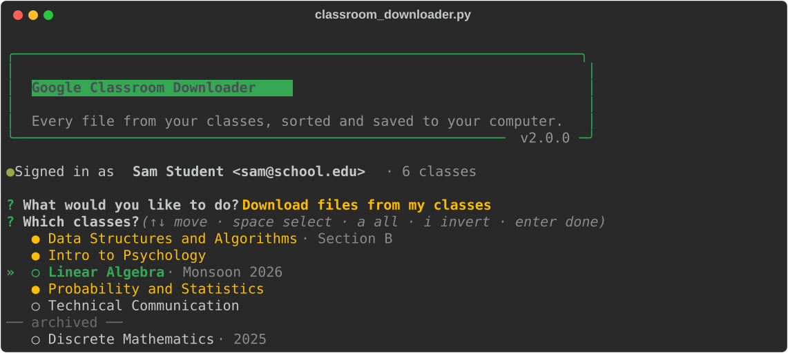

# Google Classroom Downloader (CLI)

<p align="center">
  
</p>

```bash
python3 -m pip install -r requirements.txt
python3 classroom_downloader.py
```

That's all you need. The first run walks you through a short one-time setup and sign-in, right in the terminal.

The [main README](../README.md) has the full tour, with screenshots, all the flags, and what to do if Google gives you trouble.
